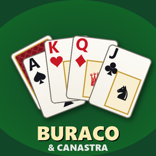

# Buraco & Canastra — mod para Project Zomboid (Build 42)

Jogue Buraco e Canastra com os baralhos (`Base.CardDeck`) que você encontra no mundo. Mesas 1x1 ou 2x2 (duplas), com outros jogadores no multiplayer e bots completando os lugares vazios — ou sozinho contra bots no singleplayer. Enquanto joga, o personagem perde tédio, tristeza e estresse.



## Como jogar

1. Tenha **2 baralhos** no inventário (configurável no sandbox).
2. Clique com o botão direito em um baralho → **Jogar Buraco / Canastra**. Mesas próximas também aparecem no menu de contexto do mundo.
3. No lobby: escolha 1x1 ou 2x2, a variante de regras (ou ajuste regra a regra na engrenagem), se quer bots, e crie a mesa. Outros jogadores próximos podem sentar nos lugares livres; o anfitrião pode adicionar/remover bots e trocar lugares antes de iniciar.

### Controles na mesa

| Ação | Como |
| --- | --- |
| Comprar | clique no monte |
| Pegar o lixo | clique no lixo (no buraco fechado: selecione as cartas que vão com a carta do topo, ou clique antes no jogo onde ela entra) |
| Selecionar cartas | clique nas cartas da mão |
| Baixar jogo novo | selecione as cartas e clique na área vazia dos seus jogos (ou no ícone de baixar) |
| Adicionar a um jogo | selecione as cartas e clique no jogo |
| Descartar | duplo clique na carta, ou selecione e clique no lixo / ícone de descarte |
| Ordenar mão | ícones de naipe / valor |
| Baralho de 4 cores (paus verde, ouros azul) | ícone dos quatro naipes no topo da mesa |
| Sair da mesa | ícone de sair, duas vezes (seu lugar passa para um bot) |

Quando há pontuação mínima para a primeira baixada, os jogos ficam "em espera" até atingir o mínimo e são confirmados juntos.

## Variantes incluídas

Buraco aberto, Buraco fechado, STBL (só sequências), Buraco 1 morto, Buraco sem morto, Buraco com coringas, Canastra clássica (trincas, 3 vermelhos, lixo congelado, mínimo progressivo) e Canastra brasileira (lixo só com a carta do topo num jogo, 3 preto e curinga no topo trancam o lixo, 3 vermelho vale 100 e compra outra carta — negativo sem canastra —, 3 preto não entra em jogos e cada 3 preto que sobrar na mão custa 100 pontos, trincas só de A, 4 e K, bate com qualquer canastra, 1 morto no 1x1 e 2 no 2x2, quem começa pode trocar a primeira carta comprada). Cada regra pode ser alterada individualmente (vira "Personalizado"): lixo livre ou fechado, lixo visível, sequências/trincas, trincas permitidas, 2 curinga, jokers, curingas por jogo, cartas na mão, compra de 1 ou 2, número e tamanho dos mortos, exigência para bater, bater com descarte, carta virada, lixo congelado, tranca do 3 preto/curinga, 3 vermelhos, mínimo da 1ª baixada, tabela de valores, bônus de canastras e batida, penalidade do morto, penalidade do 3 preto na mão e pontos para vencer.

## Opções de sandbox

| Opção | Padrão |
| --- | --- |
| Baralhos necessários | 2 |
| Distância máxima da mesa | 8 |
| Permitir bots | sim |
| Atraso dos bots (s) | 1.0 |
| Tédio / tristeza / estresse reduzidos por minuto | 0.3 / 0.1 / 0.002 |
| Bônus de felicidade ao vencer | 10 |

## Desenvolvimento

```
Contents/mods/Canastra/42/       mod (mod.info, media/)
  media/lua/shared/Canastra/     regras, motor do jogo, bots, rede
  media/lua/server/Canastra/     mesas (autoridade do jogo, também em SP)
  media/lua/client/Canastra/     cliente, menus e janelas
tests/                           testes fora do jogo (Lua 5.1 via lupa)
tools/generate_textures.py       gera ícones, cartas, poster e preview
```

Instalar localmente (cria um link de `%USERPROFILE%\Zomboid\mods\Canastra` para este repositório):

```powershell
./install-dev.ps1          # instalar
./install-dev.ps1 -Remove  # remover
```

Depois ative "Buraco & Canastra" em Mods no menu principal.

Testes (sintaxe, traduções, motor de regras, simulação de todas as variantes e partidas completas pela interface com a API do jogo simulada):

```powershell
pip install lupa
python tests/run_tests.py
```

Regenerar texturas: `pip install pillow` e `python tools/generate_textures.py`.
